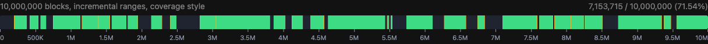

# d3-blockmap

Canvas progress bar for millions of blocks: one pixel column per bin, drawn from a packed bitset. Zoomable, themable with CSS variables, with an optional axis and a React component.



## Install

```bash
npm i @unpunnyfuns/d3-blockmap
```

Peer dependency for the React component: `react >= 19`.

## Quick start

```ts
import { createBlockMap } from '@unpunnyfuns/d3-blockmap';

const map = createBlockMap(document.querySelector('#progress')!, {
  totalBlocks: 10_000_000,
});

map.addBlocks(newIndices);              // Uint32Array or number[]
map.addRanges([[0, 123], [256, 1024]]); // [start, end) tuples
map.getProgress();                      // { completed, total }
```

The container needs a height; the canvas fills it. Leave a little space below if you turn the axis on.

```tsx
import { useRef, useState } from 'react';
import { BlockMap } from '@unpunnyfuns/d3-blockmap/react';
import type { BlockMapHandle } from '@unpunnyfuns/d3-blockmap/react';

export const Download = ({ totalBlocks }: { totalBlocks: number }) => {
  const ref = useRef<BlockMapHandle>(null);
  const [highlight, setHighlight] = useState(false);

  // Call ref.current?.addRanges(...) from your data source as ranges complete.

  return (
    <>
      <BlockMap ref={ref} totalBlocks={totalBlocks} axis highlight={highlight} style={{ height: 12 }} />
      <button onClick={() => setHighlight((on) => !on)}>Highlight missing</button>
    </>
  );
};
```

## Options

| Option | Type | Default | What it does |
|---|---|---|---|
| `totalBlocks` | `number` | required | Number of blocks, up to 2^32 − 1. |
| `initialBlocks` | `ArrayLike<number>` | | Indices already complete. |
| `initialRanges` | `RangeInput` | | `[start, end)` tuples (or a flat `Uint32Array` of pairs) already complete. |
| `partial` | `"coverage" \| "gradient"` | `"coverage"` | How partly filled columns are coloured. See Theming. |
| `view` | `{ start, end }` | full range | Initial zoom window, `end` exclusive. |
| `interactive` | `boolean` | `true` | Ctrl/⌘+wheel zooms, drag pans, double-click resets; keyboard controls when focused, see Behaviour. |
| `onViewChange` | `(view) => void` | | Called when the view changes. |
| `axis` | `boolean \| { format?, tickCount? }` | `false` | Tick labels under the bar. |
| `brush` | `boolean` | `false` | A mouse or pen drag selects a block range; panning then needs Shift. See Behaviour. |
| `onBrush` | `(selection) => void` | | Called on every brush move with the live `[start, end)` or `null`. |
| `onBrushEnd` | `(selection) => void` | | Called when the gesture ends, with the snapped `[start, end)`, or `null` when it cleared the selection. A gesture that leaves the selection as it was fires nothing. |
| `onBlockClick` | `(event) => void` | | Called on click with `{ block, range, completed, total, originalEvent }`. Works even when `interactive` is `false`. |
| `label` | `(progress) => string` | | Overrides the canvas `aria-label`. See Behaviour. |

## Methods

| Method | What it does |
|---|---|
| `setBlocks(indices)` | Replace everything with these indices. |
| `addBlocks(indices)` | Mark indices complete. Cheapest way to add single blocks. |
| `setRanges(ranges)` | Replace everything with a snapshot of ranges. |
| `addRanges(ranges)` | Mark ranges complete. Overlap is fine and counted once. |
| `removeRanges(ranges)` | Mark ranges missing again. |
| `getProgress()` | `{ completed, total }`. |
| `setView(view)` / `resetView()` / `getView()` | Zoom window control. |
| `setBrush(selection)` | Select `[start, end)` blocks, or `null` to clear. Fires no callbacks. |
| `getBrush()` | The current selection as a copy, or `null`. |
| `setHighlight(on)` | Blink incomplete columns. Steady under `prefers-reduced-motion`. |
| `getScale()` | `{ domain, range, x(block), block(x) }` to draw your own axis. |
| `destroy()` | Remove everything. |

Ranges use exclusive ends: `[0, 10]` means blocks 0 through 9. Unsorted, overlapping, and out-of-range input is normalised.

## Behaviour

- The canvas is focusable (`tabindex="0"`) when `interactive` isn't `false`, and announces progress through `role="img"` plus an `aria-label`: `label` overrides the default `Download progress: 4,343,270 of 10,000,000 blocks (43%)` text.
- With the canvas focused: `+`/`-` (or `=`/`_`) zoom in or out around the centre of the current view, arrow keys pan by 10% of the view length, Shift+arrow by 50%, and `Home` or `0` resets to the full range.
- With `brush: true`, a mouse or pen drag selects a block range and Shift+drag pans; click an empty spot to clear. The brush is a mouse and pen gesture only, so a touch drag keeps panning and needs no modifier.
- `onBlockClick` reports the block under the pointer, or the column's range when a column covers several blocks. It does not fire for a click that lands 3 px or more from where the press began, which is how a pan or a brush drag ends, nor for a click outside the canvas. A plain click with no selection present reports the block it hit; the click that clears an existing selection does not.

## React

Props mirror the options, including `label`, `brush`, `onBrush`, `onBrushEnd`, `onBlockClick`, plus `blocks`, `ranges`, `highlight`, `className`, `style`. `ref` is a plain prop exposing every method above except `destroy`, as `BlockMapHandle`.

- `blocks` and `ranges` apply when their identity changes, so keep the references stable.
- `partial`, `interactive`, `axis`, and `brush` recreate the instance when they change; memoise an object `axis`.
- `onViewChange`, `onBrush`, `onBrushEnd`, and `onBlockClick` can be inline: the latest function is called without recreating the instance.
- `setBlocks` and `setRanges` on the ref hold until the `blocks` or `ranges` prop next changes.
- For high-frequency updates use the ref (`addBlocks`, `addRanges`) rather than props.

## Theming

Set these CSS custom properties on the container or an ancestor:

| Property | Default | Used for |
|---|---|---|
| `--blockmap-missing` | `#2b2b2b` | empty columns |
| `--blockmap-complete` | `#2ecc71` | full columns |
| `--blockmap-partial` | `#e0a500` | midpoint of the `coverage` fade |
| `--blockmap-partial-low` / `-high` | `#5b3a00` / `#e0a500` | the `gradient` style |
| `--blockmap-highlight` | `#ff4d4f` | blinking incomplete columns |
| `--blockmap-brush` | `#ffffff` | brush selection |
| `--blockmap-axis-color` | `currentColor` | tick labels |

`coverage` fades missing → partial → complete by how full a column is, so range edges look crisp. `gradient` fades low → high instead, which shows density when blocks arrive scattered.

The tooltip is a `div[data-blockmap-tooltip]`, ticks are `span[data-blockmap-tick]` inside `div[data-blockmap-axis]`, and the brush overlay is an `svg[data-blockmap-brush]`; style them with CSS.

## Notes

- Memory is 1 bit per block plus one counter per pixel column. Updates cost in proportion to what changed, not to `totalBlocks`.
- When the view is narrower than the pixel width, each block is drawn as a discrete segment.
- The axis sits just below the container at `top: 100%`; don't clip it with `overflow: hidden`.
- d3 packages are external imports, not bundled; they dedupe with your own D3.
- Editing a selection that is partly outside the view re-derives both edges from the visible span, so the off-screen edge snaps to the view bound.

## Development

```bash
npm run verify      # lint, format check, typecheck, tests, build
npm run demo        # serves the repo; open /demo/
```

Files named `*.browser.test.ts(x)` run in headless Chromium; every other test is a Node unit test. One-time setup: `npx playwright install chromium` and `npm run prepare` (installs the commit-message hook). Shared test fakes live in `src/testing/`.

Commits follow [Conventional Commits](https://www.conventionalcommits.org); commitlint checks each message. Releases are automated: release-please opens a release PR from the commit history, and merging it tags the version, publishes the GitHub release, and stages the npm publish for approval with 2FA. There is no npm token anywhere.
