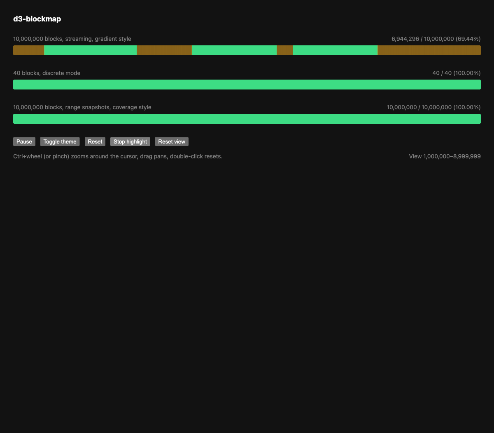

# d3-blockmap

Canvas block map for download progress across millions of opaque blocks. One column per device pixel, D3 colour interpolation, dirty-column blitting once per frame.

## Install

```bash
npm i d3-blockmap
```

## Structure

| Export | From | Purpose |
|---|---|---|
| `createBlockMap(container, options)` | `d3-blockmap` | Vanilla factory. Returns `BlockMap`. |
| `BlockMap`, `BlockMapOptions`, `Progress`, `Theme`, `BlockRangeTuple`, `RangeInput`, `PartialStyle`, `BlockView` | `d3-blockmap` | Types. |
| `<BlockMap>` | `d3-blockmap/react` | React wrapper, `forwardRef` to `BlockMapHandle`. |
| `BlockMapProps`, `BlockMapHandle` | `d3-blockmap/react` | Types. |

## Usage



```html
<div id="blocks" style="height: 12px"></div>
```

```ts
import { createBlockMap } from 'd3-blockmap';

const map = createBlockMap(document.querySelector('#blocks')!, {
  totalBlocks: 10_000_000,
  initialBlocks: downloadedSoFar,
});

socket.on('blocks', (indices: Uint32Array) => map.addBlocks(indices));
map.setRanges([[0, 123], [256, 1024]]);
map.getProgress(); // { completed, total }
map.destroy();
```

```tsx
import { useRef } from 'react';
import { BlockMap } from 'd3-blockmap/react';
import type { BlockMapHandle } from 'd3-blockmap/react';

const ref = useRef<BlockMapHandle>(null);
<BlockMap ref={ref} totalBlocks={total} blocks={initial} style={{ height: 12 }} />;
ref.current?.addBlocks(newIndices);
```

A new `blocks` array identity triggers `setBlocks`; keep the reference stable between renders unless the full set changed. `ranges` (`RangeInput`) behaves the same way via `setRanges`. When both `ranges` and `blocks` are given, ranges are applied first and blocks are added on top; any identity change of either prop re-applies the `ranges` snapshot and then adds `blocks` on top again, so keep both references stable between renders. `partial` (`"gradient" | "coverage"`) recreates the underlying instance when its value changes.

`view` (`BlockView`) applies via `setView` when its identity changes. `interactive` (`boolean`, default `true`) recreates the underlying instance when its value changes, same as `partial`. `onViewChange` is called after the view changes by API or interaction; its identity does not trigger instance recreation, so inline closures are fine. `highlight` (`boolean`) toggles blinking on incomplete bins via `setHighlight`.

`BlockMapHandle` also exposes an imperative `setRanges(ranges)`, bypassing React state, for high-frequency snapshots where re-rendering on every tick would be wasteful. Do not combine it with the `ranges` prop; the prop's own effect will re-apply and fight the imperative calls. The handle additionally exposes `setView(view)`, `resetView()`, `getView()`, and `setHighlight(on)` for the same imperative use case.

## API

### `createBlockMap(container, options)`

| Option | Type | Notes |
|---|---|---|
| `totalBlocks` | `number` | Positive integer up to 2^32 − 1 (indices are stored as unsigned 32-bit). Memory is 1 bit per block plus one counter per pixel. |
| `initialBlocks` | `ArrayLike<number>` | Optional. Indices already complete. |
| `initialRanges` | `RangeInput` | Optional. `[start, end)` tuples or a flat `Uint32Array` of pairs. Applied before `initialBlocks`. |
| `partial` | `"gradient" \| "coverage"` | Default `"coverage"`. `"gradient"` is opt-in and blends between the two partial colours instead of missing-to-complete. |
| `view` | `BlockView` | Optional. Initial `{ start, end }` window in block indices, `end` exclusive. |
| `interactive` | `boolean` | Default `true`. Ctrl+wheel or pinch zooms around the cursor, drag pans, double-click resets. |
| `onViewChange` | `(view: BlockView) => void` | Called after the view changes by API or interaction. |

Returns:

| Method | Description |
|---|---|
| `setBlocks(indices)` | Replace all state. |
| `setRanges(ranges)` | Replace all state from a snapshot of `[start, end)` tuples. Any sizes, unsorted and overlapping allowed. O(ranges log ranges + bins + totalBlocks / 8). |
| `addBlocks(indices)` | Add newly completed indices. O(indices). Duplicates and out-of-range skipped. |
| `getProgress()` | `{ completed, total }`. |
| `setView(view)` | Clamp and apply a view window; repaints and calls `onViewChange` if it changed. |
| `resetView()` | Back to the full range. |
| `getView()` | Current `{ start, end }`. |
| `setHighlight(on)` | Blink every incomplete bin between its colour and `--blockmap-highlight` at 2 Hz. Steady under `prefers-reduced-motion`. |
| `destroy()` | Remove canvas, tooltip, observers. Idempotent. |

### Theming

Colours are read from CSS custom properties on the container at start and on theme change (`class`, `style`, `data-theme` on `<html>`, or `prefers-color-scheme`).

| Property | Default |
|---|---|
| `--blockmap-missing` | `#2b2b2b` |
| `--blockmap-partial-low` | `#5b3a00` |
| `--blockmap-partial-high` | `#e0a500` |
| `--blockmap-partial` | `#e0a500` |
| `--blockmap-complete` | `#2ecc71` |
| `--blockmap-highlight` | `#ff4d4f` |

Fully missing and fully complete bins use the exact endpoint colours. By default (`partial: "coverage"`), partial bins fade `--blockmap-missing` → `--blockmap-partial` → `--blockmap-complete` by bin fill fraction. `partial: "gradient"` is opt-in and interpolates partial bins between `--blockmap-partial-low` and `--blockmap-partial-high` instead; those two variables apply only to `"gradient"`. `--blockmap-highlight` is the blink colour for incomplete bins while highlight is on (see `setHighlight` below).

#### Tooltip

The tooltip element carries the attribute `data-blockmap-tooltip` and ships unstyled apart from positioning. Style it yourself:

```css
[data-blockmap-tooltip] {
  background: #111;
  padding: 4px 8px;
  border-radius: 4px;
  font-size: 12px;
}
```

### Behaviour

- Bin count equals rendered width in device pixels. Blocks map to bins by `floor(index × binCount / totalBlocks)`.
- When `totalBlocks` is less than the width, each block is drawn as a discrete segment.
- Hovering shows block range, count, and percentage for the column.
- Resize and `devicePixelRatio` changes rebuild bins from the internal bitset in one pass.
- Resize rebuilds bin counts with a byte-level popcount over the bitset, O(totalBlocks / 8 + bins).
- The container is set to `position: relative` if it is static, so the tooltip can be positioned inside it.
- The container must have a height; the canvas fills it via `width: 100%; height: 100%`.
- Range ends are exclusive. Tuples are clamped to the block range; empty or inverted tuples are dropped; overlapping and touching tuples merge.
- Zooming keeps the block under the cursor at the same column; the view is clamped to the block range with a minimum of one block.
- Bins are computed over the current view, so zooming far enough in switches to discrete per-block segments.

## Development

```bash
npm test
npm run lint
npm run format
npm run typecheck
npm run build
```
